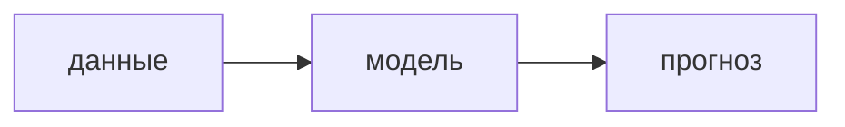

# N. Название главы

<!--
Шпаргалка по главе книги. Этот файл в книгу не входит (папка _templates исключена из сборки):
копируй отсюда нужные куски. Синтаксис — MyST Markdown, документация: https://jupyterbook.org/en/stable/content/myst.html

Где что лежит в теме:
  <тема>/chapters/NN-название.md     — глава книги (этот формат)
  <тема>/chapters/img/...             — картинки для глав (графики, экспортированные из ноутбуков)
  <тема>/notebooks/NN-название.ipynb  — рабочий ноутбук с кодом; в книгу не входит
Новая глава появляется в книге, только когда её добавили в _toc.yml.
Все возможности оформления с живыми примерами — страница «Возможности книги» (_local/showcase/showcase.md, в git не попадает).
Она видна в книге при локальной сборке: bash _local/build.sh
-->

Короткий абзац: о чём глава и зачем это нужно.

## Теория

Обычный текст, **жирный**, `код`, [ссылка](https://jupyterbook.org).

Формула в строке: $y_t = \hat y_t + e_t$. Формула отдельной строкой:

$$
\hat y_t = \frac{1}{m} \sum_{i=1}^{m} \hat y_t^{(i)}
$$

| колонка | ещё колонка |
|---|---|
| значение | значение |

## Вопрос

Вопрос виден сразу, ответ раскрывается по клику — удобно спросить и дать подумать.

:::{dropdown} Ответ
Текст ответа. Внутри работает всё то же: формулы, таблицы, картинки, списки.
:::

## Выводы задания

:::{dropdown} Выводы
- первый вывод;
- второй вывод.
:::

## Заметки на полях

:::{note}
Нейтральная заметка: определение, напоминание.
:::

:::{important}
То, что легко упустить.
:::

:::{tip}
Практический совет.
:::

:::{warning}
Подвох или расхождение с документацией.
:::

## Картинка из ноутбука

Сохрани график в ноутбуке (`fig.savefig("../chapters/img/имя.png", dpi=150, bbox_inches="tight")`)
и вставь его так:

```{image} img/имя.png
:alt: что на картинке
:width: 600px
```

## Код

Код показываем блоком — он не запускается, это просто текст:

```python
from etna.models import NaiveModel

model = NaiveModel(lag=7)
```

## Схема


